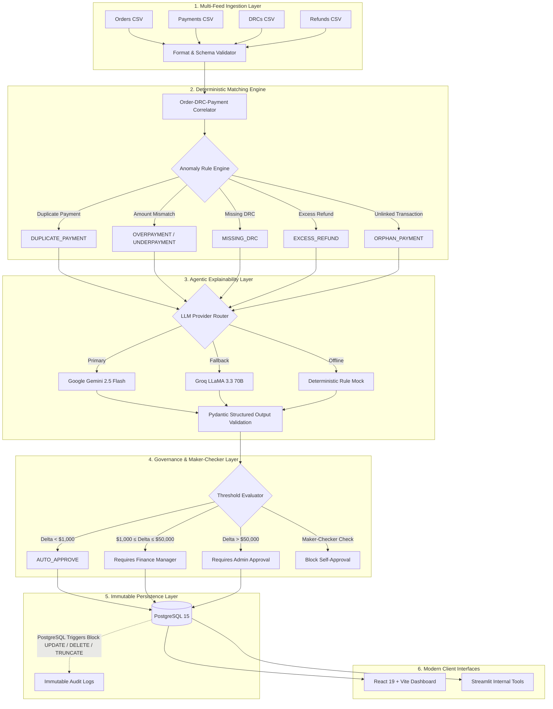

# ⚡ Aequitas Recon — Autonomous Multi-Engine Financial Reconciliation Platform

[](https://reconciliation-agent-five.vercel.app/)
[](https://fastapi.tiangolo.com)
[](https://react.dev)
[](https://www.postgresql.org)
[](https://www.docker.com)
[-brightgreen?style=for-the-badge&logo=pytest&logoColor=white)](tests/)
[](LICENSE)

An enterprise-grade, agentic financial reconciliation and anomaly detection platform. It ingests high-volume multi-source financial feeds (**Orders, Payments, Delivery Receipt Confirmations (DRCs), and Refunds**), executes a **100% deterministic rule engine** for mathematical precision, and pairs each discrepancy with a **Multi-Engine AI reasoning layer** (Gemini 2.5 Flash / Groq LLaMA 3.3) for explainability, automated resolution proposals, and strict **Maker-Checker governance**.

---

## 🌐 Live Interactive Application

Experience the live production application immediately:

### 🚀 **[https://reconciliation-agent-five.vercel.app/](https://reconciliation-agent-five.vercel.app/)**

* **Interactive Showcase Mode**: Instant full-feature demonstration mode with simulated financial ledgers, audit events, and AI decisions — zero backend cold starts or wait times.
* **Live Hybrid Connectivity**: Switch seamlessly between cloud simulation and live backend instances (`http://localhost:8000` or hosted FastAPI) via the in-app **API Settings** modal.
* **Role Simulation**: Instant one-click switching between **Auditor**, **Finance Manager**, and **Admin** to test financial approval thresholds.

---

## 🏛️ System Architecture



---

## 🌟 Key Capabilities

### 1. Zero-Hallucination Deterministic Engine
Financial math and matching are strictly deterministic. LLMs never calculate balances, mutate ledger states, or execute raw database queries. The Python rule engine calculates deltas with floating-point tolerance guards ($0.01), ensuring 100% mathematical auditability.

### 2. Multi-Engine AI Reasoning & Explainability
* **Gemini 2.5 Flash & Groq LLaMA 3.3 Integration**: Translates complex, multi-table delta anomalies into concise, plain-English explanations with root cause diagnosis.
* **Suggested Next Actions**: Generates standardized accounting remediation steps (`REVERSE_PAYMENT`, `ISSUE_REFUND`, `REQUEST_FUNDS`, `REQUEST_DOCUMENT`, `ESCALATE`).
* **Resilient Graceful Fallbacks**: If API quotas or network timeouts occur, the pipeline automatically fails over across providers or deterministic mock generators without breaking reconciliation runs.

### 3. Maker-Checker Financial Governance
* **Self-Approval Prevention**: The user who triggers a reconciliation run is recorded as the *Maker* and is strictly forbidden from approving or rejecting the resulting discrepancies.
* **Tiered Financial Thresholds**:
  * **Level 1 (< $1,000)**: System auto-approval eligible.
  * **Level 2 ($1,000 – $50,000)**: Requires review by a `FINANCE_MANAGER` or `ADMIN`.
  * **Level 3 (> $50,000)**: Strictly requires high-level `ADMIN` authorization.

### 4. Cryptographic & Database-Enforced Audit Immutability
* Every action (login, file ingestion, reconciliation execution, human approval/rejection) is written to `audit_logs`.
* **PostgreSQL Triggers**: Hard database-level trigger functions raise runtime exceptions on any attempt to `UPDATE`, `DELETE`, or `TRUNCATE` the audit trail.

---

## 📂 Project Directory Structure

```text
├── .github/workflows/          # CI/CD GitHub Actions pipelines
├── api/                        # FastAPI application layer
│   ├── routers/                # REST endpoints (auth, runs, discrepancies, uploads, audit)
│   ├── dependencies.py         # JWT auth and dependency injection
│   └── main.py                 # FastAPI application factory
├── core/                       # Core configuration, security, and logging
│   ├── config.py               # Pydantic Settings & environment variables
│   ├── logging.py              # Structured JSON logging
│   └── security.py             # JWT token handling & password hashing
├── db/                         # Database models, schemas, and migrations
│   ├── migrations/             # Alembic database migrations
│   ├── database.py             # SQLAlchemy engine & session factory
│   ├── models.py               # SQLAlchemy ORM models
│   ├── schemas.py              # Pydantic v2 schemas
│   └── seed.py                 # Realistic dataset seeder with 50 deliberate anomalies
├── demo_data/                  # Standardized CSV benchmark files
│   ├── orders.csv              # Purchase orders
│   ├── payments.csv            # Bank & payment gateway feeds
│   ├── drcs.csv                # Warehouse delivery receipt confirmations
│   ├── refunds.csv             # Customer refunds
│   └── test_thresholds/        # High-value and boundary test sets
├── docs/                       # Architecture and engineering documentation
│   ├── specs/                  # Requirements and design specifications
│   ├── ARCHITECTURE.md         # Comprehensive architectural breakdown
│   ├── AGENT_SAFEGUARDS.md     # AI safety, sanitization, and fallback protocols
│   ├── DIAGRAMS.md             # Detailed sequence and ER diagrams
│   ├── TRADEOFFS.md            # System design tradeoffs and performance limits
│   └── DEPLOYMENT.md           # Deployment runbooks
├── frontend/                   # Modern React 19 + Vite web application
│   ├── src/                    # Components, views, charts, and API client
│   ├── public/                 # Static branding assets
│   └── vercel.json             # Vercel deployment configuration
├── monitoring/                 # System observability and metrics
├── scripts/                    # CLI execution utilities and deployment helpers
│   ├── run_pipeline_on_csvs.py # CLI reconciliation batch runner
│   ├── run_instant_test.py     # Standalone integration verification script
│   ├── generate_test_thresholds.py # Test dataset generator
│   └── test_logins.sh          # Authentication curl validation suite
├── services/                   # Business logic and domain services
│   ├── reconciliation/         # Reconciliation pipeline & multi-agent system
│   │   ├── agents/             # Matching, Anomaly, and Resolution agents
│   │   ├── llm/                # Gemini, Groq, and Mock LLM adapters
│   │   └── pipeline.py         # End-to-end reconciliation pipeline orchestrator
│   ├── approvals.py            # Maker-Checker and threshold validation service
│   ├── audit.py                # Audit log service
│   └── csv_utils.py            # Stream parser & CSV injection sanitization
├── tests/                      # Full pytest test suite (34 unit & integration tests)
├── ui/                         # Streamlit secondary internal tools
├── Dockerfile                  # Production container definition
├── docker-compose.yml          # Local multi-service orchestration (API + DB + UI)
├── Makefile                    # Developer workflow shortcuts
└── requirements.txt            # Python dependencies
```

---

## ⚡ Quickstart Guide

### Option 1: Docker Compose (Recommended)

Get the complete environment running locally in three commands:

```bash
# 1. Clone the repository and configure environment variables
git clone https://github.com/Manishrao07/reconciliation-agent.git
cd reconciliation-agent
cp .env.example .env

# 2. Start PostgreSQL, FastAPI Backend, and Streamlit UI
docker compose up -d

# 3. Apply database migrations and seed realistic demo data
make reset-demo
```

Access the local services:
* **React Web App**: `http://localhost:3000` (run `cd frontend && npm install && npm run dev`)
* **FastAPI Swagger API Docs**: `http://localhost:8000/docs`
* **Streamlit Ops Portal**: `http://localhost:8505`

---

### Option 2: Local Python & Node Setup

#### 1. Backend Setup
```bash
python3 -m venv venv
source venv/bin/activate
pip install -r requirements.txt
cp .env.example .env

# Start PostgreSQL (or run docker compose up -d db)
alembic upgrade head
python -m db.seed

# Run the API server
uvicorn api.main:app --reload --port 8000
```

#### 2. Frontend Setup
```bash
cd frontend
npm install
npm run dev
```

---

## 🔐 Demo Credentials & RBAC

The seeded database comes with role-based demo accounts (password: value of `SEED_DEMO_PASSWORD` in `.env.example`, default: `Demo#Pass123`):

| Role | Email | Approval Permissions | Audit Rights |
|---|---|---|---|
| **Admin** | `admin@example.com` | Unlimited (All tiers > $50k) | Full View |
| **Finance Manager** | `manager@example.com` | Standard ($1,000 – $50,000) | Full View |
| **Auditor** | `auditor@example.com` | Read-only (Cannot approve) | Full View |

> **Maker-Checker Note**: If an Admin triggers a reconciliation run, that Admin *cannot* approve discrepancies from that specific run. A different Admin or Manager must review it.

---

## 🧪 Testing & Verification

The test suite covers unit logic, LLM fallback behavior, API security, CSV injection defenses, and UI clients:

```bash
# Run tests locally
PYTHONPATH=. pytest tests/ -v

# Run tests in Docker container
make test-docker
```

**Results**: 34 passed tests, 0 failures.

---

## 📄 License & Security

* **Security Policy**: See [SECURITY.md](SECURITY.md) for vulnerability reporting and safeguards.
* **Architecture Specifications**: See [docs/ARCHITECTURE.md](docs/ARCHITECTURE.md) and [docs/AGENT_SAFEGUARDS.md](docs/AGENT_SAFEGUARDS.md).
* **License**: MIT License.
