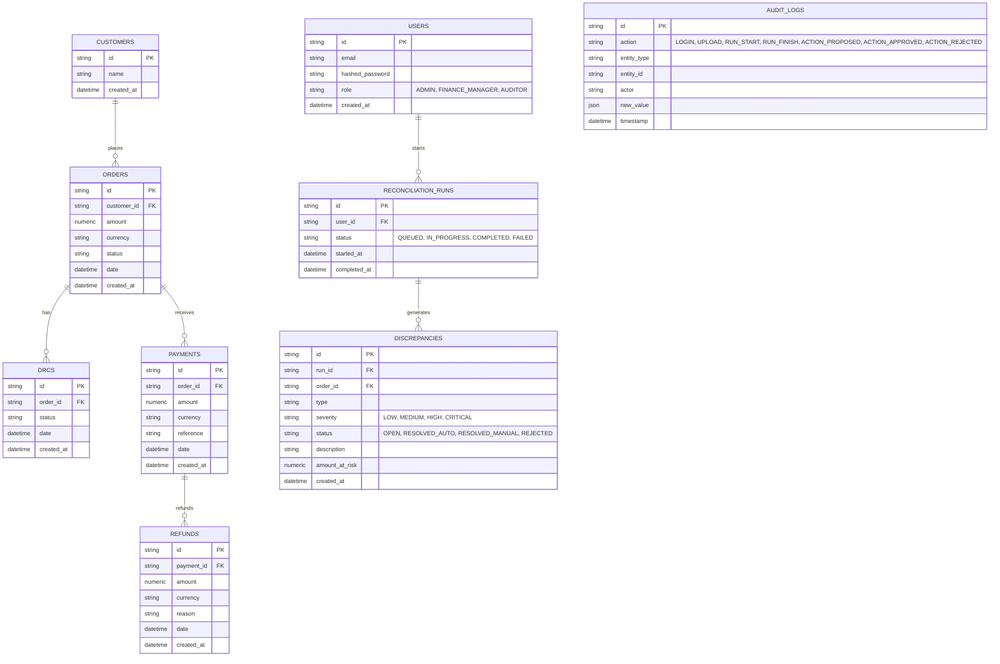
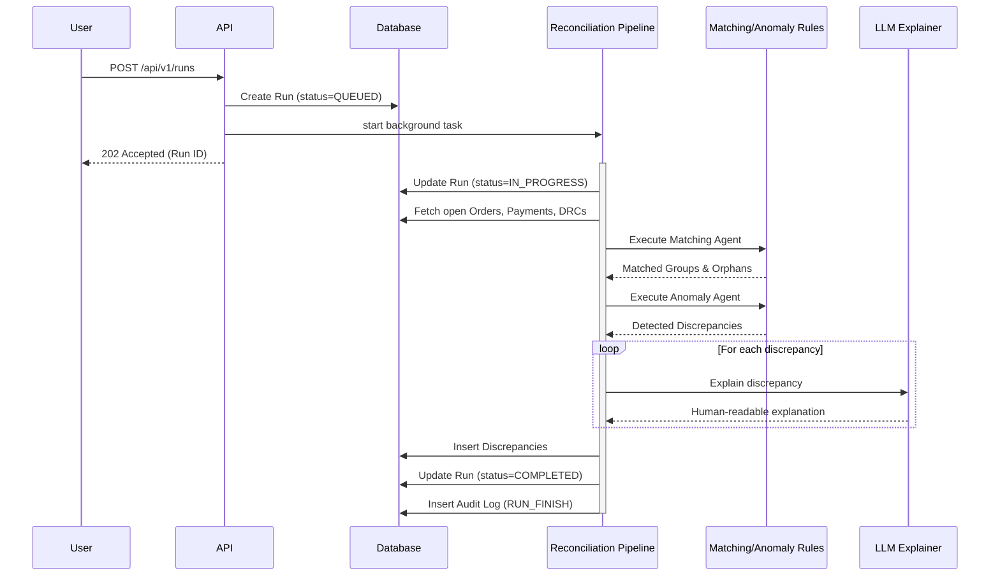
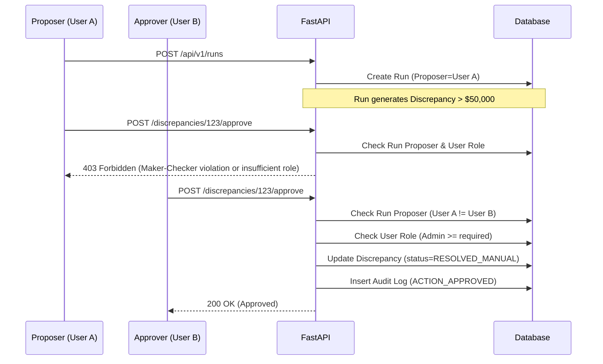
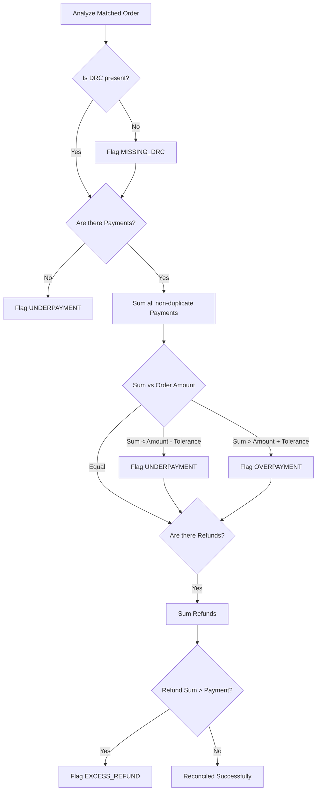
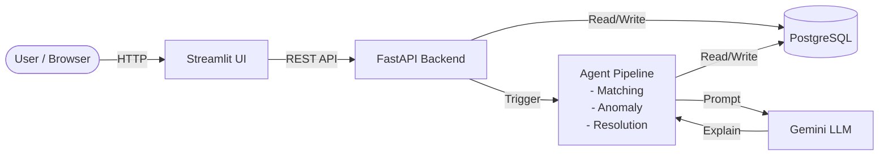
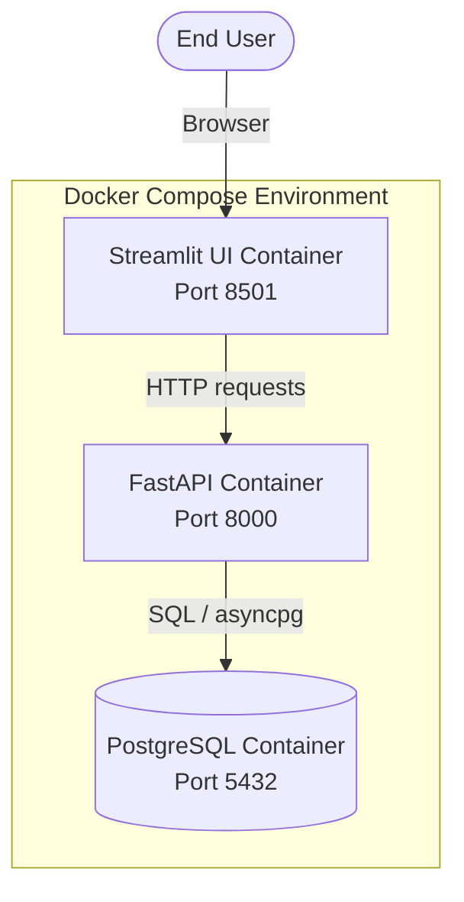
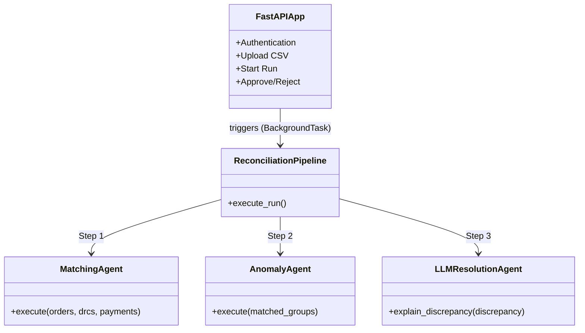

# Architecture Diagrams

This document contains Mermaid diagrams illustrating the structure and workflows of the Autonomous Finance Reconciliation Agent.

## 1. Entity Relationship (ER) Diagram

## 2. Sequence Diagram: Reconciliation Run

This sequence diagram illustrates the pipeline of a reconciliation run.

## 3. Sequence Diagram: Approval Workflow (Maker-Checker)

This sequence diagram illustrates the maker-checker logic for resolving a discrepancy.

## 4. Detection Flowchart

This flowchart demonstrates how the Anomaly Agent classifies discrepancies.

## 5. High-Level Architecture Diagram

## 6. Deployment Diagram

## 7. Component Diagram

